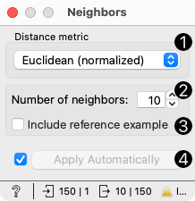
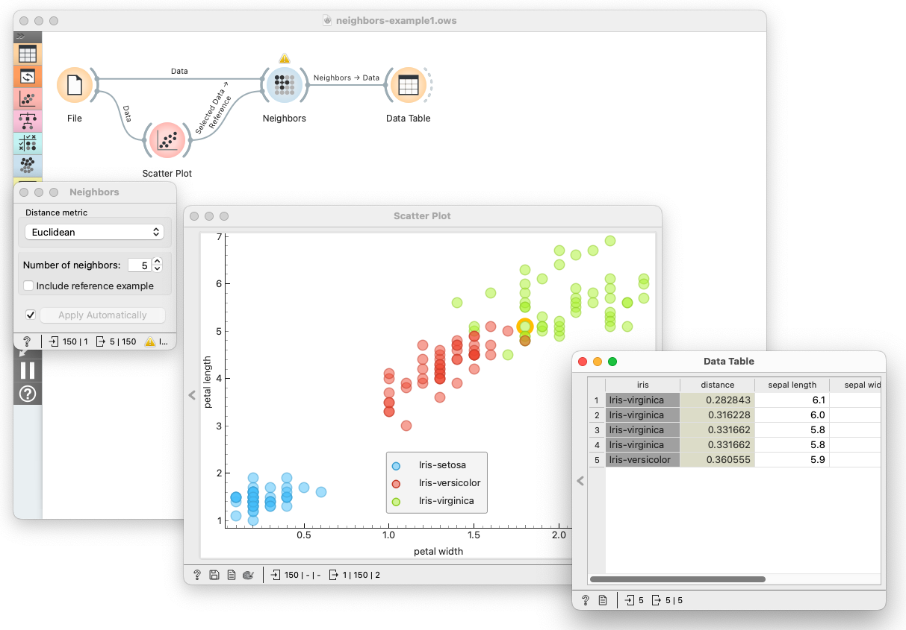
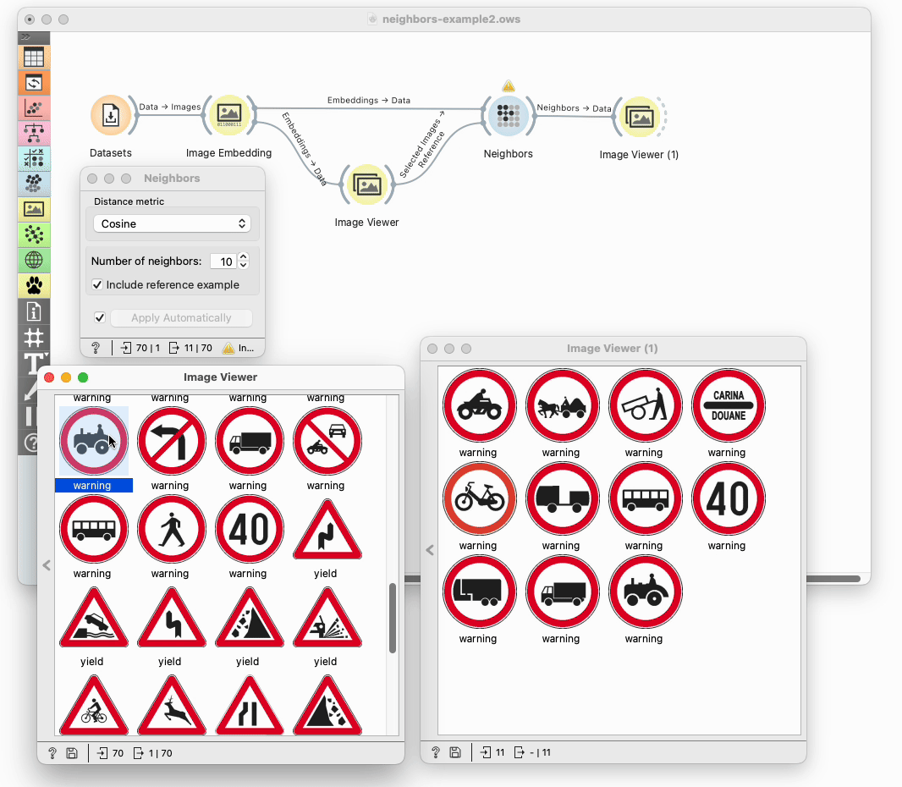

Neighbors
=========

Compute nearest neighbors in data according to reference.

**Inputs**

- Data: An input data set.
- Reference: A reference data for neighbor computation.

**Outputs**

- Neighbors: A data table of nearest neighbors according to reference.
- Data with distances: A data table of nearest neighbors according to reference with an additional column containing distances to the reference or the closes reference.

The **Neighbors** widget computes distances from the given reference instance and returns the nearest neighbors. If multiple refernce instances are given, the widget computes distances to the closest reference instance.

{width=50%}

1. *Distance metric* for computing neighbors. Supported measures are: Euclidean, normalized Euclidean, Manhattan, normalized Manhattan, Mahalanobis, Hamming, Cosine, Pearson, absolute Pearson, Spearman, absolute Spearman, and Jaccard.
2. *Number of neighbors*: Sets the number of neighbors on the output.
3. *Include reference example*: If checked, the reference example(s) will be added to the output.
2. Click *Apply* to commit the changes. To communicate changes automatically tick *Apply Automatically*.

Examples
--------

In the first example, we used *iris* data and passed it to **Neighbors** and to [Scatter Plot](../visualize/scatterplot.md). We connected the Scatter Plot to the Neighbors widget so that it would provide a reference instance.

We can now select a reference instance in the Scatter Plot, and the Neighbors widget will compute the closest neighbors to that instance. We can observer the results in, for example, the Data Table.

In the screenshot we selected an instance of iris virginica that is similar to iris versicolor. Indeed, we see in the Table that four of its five closes neighbors are virginicas, while one is a versicolor.

Another example requires the installation of Image Analytics add-on. We loaded traffic signs dataset from the [Datasets](../data/datasets.md) widget and passed them to [Image Embedding](https://orangedatamining.com/widget-catalog/image-analytics/imageembedding/), with which we embedded the images. Remember, Neighbors widget (and any kind of downstream processing of images), requires numerically described instances.

Then the procedure is the same as above. We passed embedded images to [Image Viewer](https://orangedatamining.com/widget-catalog/image-analytics/imageviewer/), which we would use to selectetraffic signs as our reference image. We passed the image to Neighbors, where we set the distance measure to *cosine* and observe the results in another Image Viewer.

By clicking traffic signs in the first Image Viewer, we can see the closest neighbors in the second Image Viewer.

